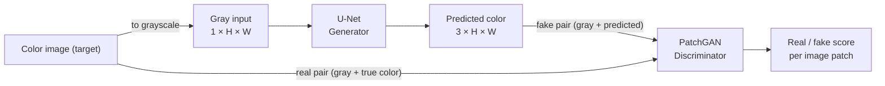

<div align="center">

# pix2pix-colorfication

**Turning grayscale photos into color with a conditional GAN (pix2pix).**

[](https://www.python.org/)
[](https://pytorch.org/)
[](https://hydra.cc/)
[](https://wandb.ai/)
[](http://places2.csail.mit.edu/)
[](LICENSE)

</div>

---

## Overview

This project trains a deep learning model to **colorize grayscale images**. It follows the
[pix2pix](https://arxiv.org/abs/1611.07004) recipe for image-to-image translation:

- A **U-Net generator** takes a 1-channel grayscale image and predicts a 3-channel RGB image.
- A **PatchGAN discriminator** sees the grayscale input next to a color image and decides, patch by patch, whether the color is real or generated.
- The generator learns from an **adversarial loss** (to fool the discriminator) plus a weighted **L1 loss** (to stay close to the true colors).

Models are trained on the [Places365](http://places2.csail.mit.edu/) scene dataset, which
`torchvision` downloads automatically.

## How it works



**Training objective** (from `patch_train.py`):

$$
\mathcal{L}_G = \mathcal{L}_{\text{BCE}}\big(D(x, G(x)),\ 1\big) + \lambda \cdot \lVert y - G(x) \rVert_1, \qquad \lambda = 100
$$

$$
\mathcal{L}_D = \tfrac{1}{2}\Big[\mathcal{L}_{\text{BCE}}\big(D(x, y),\ 1\big) + \mathcal{L}_{\text{BCE}}\big(D(x, G(x)),\ 0\big)\Big]
$$

| Setting | Value |
| --- | --- |
| Dataset | Places365 (small, 256×256), `train-standard` / `val` / `test` splits |
| Augmentation | 128×128 random crop, horizontal/vertical flips, brightness jitter |
| Generator optimizer | Adam, lr `1e-4`, weight decay `1e-4`, StepLR (×0.5 every 5 epochs) |
| Discriminator optimizer | Adam, lr `1e-4`, betas `(0.5, 0.999)` |
| Batch size | 256 |
| Validation metric | L1 / MAE between prediction and true color |

## Project structure

```text
pix2pix-colorfication/
├── configs/
│   ├── model.yaml          # Hydra config: channels, image size, batch size
│   └── preprocessing.yaml  # Hydra config: image folder, size, batch size, shuffle
├── models/
│   ├── generator.py        # pix2pix U-Net generator (8 down / 7 up blocks) + smoke test
│   └── discriminator.py    # Hydra-based PatchGAN discriminator (work in progress)
├── data_loader.py          # Places365 dataset → (grayscale, RGB) pairs with augmentation
├── unet.py                 # Classic U-Net generator used by the training scripts
├── discriminator.py        # PatchGAN discriminator used by the training scripts
├── train.py                # Baseline: U-Net trained with MSE only (no GAN)
├── unet_pretrain.py        # Baseline: pretrained U-Net (milesial/Pytorch-UNet) fine-tuned
├── patch_train.py          # Main pix2pix training: U-Net + PatchGAN (adversarial + L1)
├── test.py                 # Evaluate a checkpoint on the test split and save sample images
├── preprocessing.py        # Hydra-based dataset loader for your own images (work in progress)
├── requirements.txt
└── LICENSE
```

## Getting started

### 1. Install

```bash
git clone https://github.com/rasmusmolby/pix2pix-colorfication.git
cd pix2pix-colorfication

python -m venv .venv
source .venv/bin/activate

pip install -r requirements.txt
```

> [!NOTE]
> Hydra is pinned to the `1.4.0rc1` release candidate because the project runs on Python 3.14.

### 2. Train

```bash
python patch_train.py
```

`patch_train.py` logs losses to Weights & Biases (you will be asked to log in), saves a
checkpoint whenever the validation L1 improves, and writes a sample prediction every other
epoch to `test_output_images/`. Training resumes automatically from the checkpoint if it exists.

> [!IMPORTANT]
> The data and checkpoint paths are currently hard-coded for the training cluster
> (`/ceph/project/colorfication/...`). Change `data_path` and `checkpoint_path` in `main()`
> before running on your own machine. The Places365 download is large.

### 3. Evaluate

```bash
python test.py
```

`test.py` loads the generator from `checkpoint/patch/patch_unet_places_cropped_adam_step.tar`,
reports the mean absolute error on the Places365 test split, and saves a few prediction/target
pairs to `test_output_images/places_cropped/`. It uses CUDA, Apple MPS or the CPU, whichever is available.

## Hydra configs (new pipeline)

The `models/` package and `preprocessing.py` are a cleaner, config-driven rewrite that is still
in progress. Settings live in [`configs/model.yaml`](configs/model.yaml) and
[`configs/preprocessing.yaml`](configs/preprocessing.yaml), and you can override any of them from
the command line:

```bash
python models/generator.py                       # smoke test: 1×1×256×256 → 1×3×256×256
python models/generator.py batch_size=2          # override a value for one run
python preprocessing.py image_dir=data batch_size=8
python models/discriminator.py --cfg job         # print the resolved config without running
```

- The generator expects 256×256 inputs (larger multiples of 256 also work).
- Put your images (`.jpg`, `.jpeg`, `.png`) in `data/` before running preprocessing, or pass `shuffle=false` if the folder is empty.
- Hydra saves run logs and the resolved settings in `outputs/`.


## Acknowledgements

- Isola et al., [*Image-to-Image Translation with Conditional Adversarial Networks*](https://arxiv.org/abs/1611.07004) (pix2pix), CVPR 2017
- Zhou et al., [*Places: A 10 Million Image Database for Scene Recognition*](http://places2.csail.mit.edu/)
- The U-Net in `unet.py` follows [this tutorial by Fernando Palomino](https://medium.com/@fernandopalominocobo/mastering-u-net-a-step-by-step-guide-to-segmentation-from-scratch-with-pytorch-6a17c5916114)
- The pretrained baseline uses [milesial/Pytorch-UNet](https://github.com/milesial/Pytorch-UNet)

## License

Released under the [MIT License](LICENSE).
